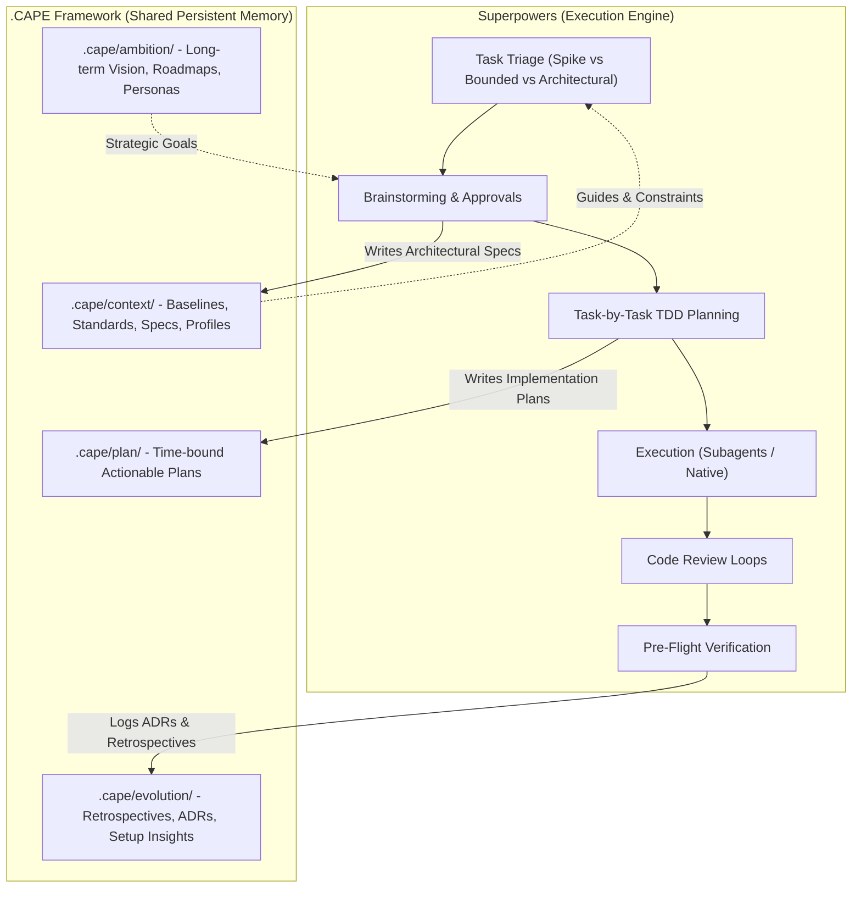

# .CAPE + Superpowers Multi-Agent Collaboration Specification

**Status:** Approved  
**Date:** 2026-10-19  
**Category:** Context / Architecture  
**Summary:** Specification establishing the Harmonized Protocol between .cape and superpowers for multi-agent workflows.  
**Target Repository:** `radical-transparency-net.github.io`  
**Related Pull Request:** [#1: Feat/cape init](https://github.com/radical-transparency-net/radical-transparency-net.github.io/pull/1)  
**Authors:** Cedric D (`cedricd`), Marc Portier (`mpo-vliz`), Antigravity Agent  

---

## 1. Executive Summary & Problem Statement

Pull Request [#1](https://github.com/radical-transparency-net/radical-transparency-net.github.io/pull/1) introduced the **`.cape`** (Context, Ambition, Plan, Evolution) framework to create a persistent, version-controlled repository memory shared by human contributors and AI coding agents. In commit `9b514a9`, early Vite portal design specs and scaffolding plans were migrated from `docs/superpowers/` directly into `.cape/context/` and `.cape/plan/`, deleting the legacy `docs/` folder to eliminate duplicate truth.

However, standardizing on `.cape` exposed operational friction points when operating with agentic workflows (Superpowers):
1. **Path Divergence:** Superpowers skills (`brainstorming`, `writing-plans`, etc.) default to `docs/superpowers/specs/` and `docs/superpowers/plans/`. Without explicit realignment, agents attempt to recreate the deleted `docs/` folder.
2. **Noise vs. Signal (Macro vs. Micro Plans):** `.cape/plan/` holds macro-migration roadmaps (e.g., linksets, repository taxonomy). If every granular, ephemeral TDD task plan (5–10 unit testing steps) were dumped into `.cape/plan/index.md`, the index would suffer from table bloat and git merge conflicts.
3. **Multi-Harness Agnosticism:** Contributors use different agent environments (Antigravity IDE / `agy`, Claude Code, Gemini CLI, Cursor, Codex). The repository lacked a universal, harness-agnostic entrypoint to instruct all agents to respect `.cape` conventions.
4. **Task Granularity Ambiguity:** Unclear whether `.cape` required a document for every minor change.

This specification formalizes the **Harmonized Protocol**: Superpowers serves as the **Execution Engine**, while `.cape` serves as the **Persistent Memory Ontology**.

---

## 2. Separation of Concerns: Engine vs. Ontology



- **Superpowers (The How):** Controls agent cognition, stage-gate approvals, test-driven development (TDD), prompt templates, and code quality verification.
- **`.cape` (The Where & What):** Authoritative, human-and-agent readable repository memory. Retains strategic intent, architectural constraints, active initiatives, and historical lessons.

---

## 3. Task Sizing & Proportional Footprint

To prevent documentation bloat and maintain team velocity, `.cape` file creation is strictly gated by task scope:

| Classification | Scope & Intent | Superpowers Process | `.cape` Footprint |
| :--- | :--- | :--- | :--- |
| **Spike** | Feasibility question, exploratory code | 2–3 sentence chat pitch $\rightarrow$ human approval $\rightarrow$ cheap probe $\rightarrow$ reported recommendation | **Zero `.cape` footprint** (In-chat only, code remains throwaway) |
| **Bounded** | Well-scoped fix or enhancement to existing code (1–3 files) | Clarifying question $\rightarrow$ short in-chat design $\rightarrow$ human approval $\rightarrow$ TDD execution | **Zero `.cape` footprint** (Code, unit tests, and git commit only) |
| **Architectural** | New subsystems, schema changes, multi-file interfaces, major features | Full `/brainstorming` $\rightarrow$ written spec $\rightarrow$ `/writing-plans` $\rightarrow$ TDD execution $\rightarrow$ review $\rightarrow$ verify | **Full `.cape` lifecycle** (Spec in `context/`, Plan in `plan/`, Log in `evolution/`) |

---

## 4. Path & Artifact Routing Schema

The legacy `docs/superpowers/` path is permanently retired in favor of `.cape`:

### 4.1 Design Specifications
- **Trigger:** Output of `/brainstorming` for architectural work.
- **Location:** `.cape/context/YYYY-MM-DD-<topic>-design.md`
- **Rationale:** Technical specifications define component architectures, data models, and interface contracts, directly fulfilling `.cape/context/` ("architectural baselines and technical choices").

### 4.2 Implementation Plans
- **Trigger:** Output of `/writing-plans` following design approval.
- **Location:** `.cape/plan/YYYY-MM-DD-<feature>-plan.md`
- **Initial Status:** `**Status:** In Progress`
- **Completion Status:** `**Status:** Complete` upon passing tests and pre-flight verification.
- **Rationale:** Concrete, task-by-task execution steps belong in `.cape/plan/` ("time-bound actionable task lists ready for execution").

### 4.3 Retrospectives & Architectural Decision Records (ADRs)
- **Trigger:** Major feature completion, milestone release, or cross-platform insight.
- **Location:** `.cape/evolution/YYYY-MM-DD-<topic>-retro.md` (or ADR).
- **Rationale:** Captures why choices were made, performance observations, and lessons learned.

---

## 5. Harness-Agnostic Entrypoint (`AGENTS.md`)

To guarantee seamless behavior across different AI harnesses without prompt engineering per session, a centralized instruction hierarchy is deployed:

```text
/ (Repository Root)
├── AGENTS.md        <-- Authoritative multi-agent instructions
├── CLAUDE.md        <-- Includes / references AGENTS.md
└── GEMINI.md        <-- Includes / references AGENTS.md
```

### 5.1 Content of `AGENTS.md`
1. **Pre-flight Context Ingestion:**
   Before answering questions or proposing code changes, every agent MUST read:
   - `.cape/context/2026-10-09-architecture.md` (Vite, Tailwind, HashRouter, component decoupled data model)
   - `.cape/context/2026-10-09-repo-structure.md` (Directory taxonomy, `.cape`, `.material`, `src/`)
   - `.cape/context/2026-10-11-style-and-sensitivity.md` (Zero conversational filler, intellectual peer tone, zero credentials)
2. **Proportional Gating Enforcement:**
   - Spikes & Bounded changes: do not create `.cape` files.
   - Architectural changes: follow Superpowers process and write to `.cape/`.
3. **Artifact Path Routing:**
   - Specs $\rightarrow$ `.cape/context/`
   - Plans $\rightarrow$ `.cape/plan/`
   - Retrospectives $\rightarrow$ `.cape/evolution/`
4. **Pre-PR Verification:**
   - Mandatory execution of `npm run verify` (typecheck, bundle build, and index synchronization) before creating or updating PRs.

---

## 6. Deterministic Indexing Tooling (`npm run cape:index`)

Instead of relying on LLMs or humans to manually edit and sort Markdown tables in `.cape/*/index.md`, a deterministic Node script is introduced:

### 6.1 Script Specification (`scripts/update-cape-index.mjs`)
- **Inputs:** Scans `.cape/context/`, `.cape/ambition/`, `.cape/plan/`, and `.cape/evolution/`.
- **Parsing:**
  - Extracts the date from `YYYY-MM-DD-*.md`.
  - Extracts the title from `# Title` (Line 1).
  - Extracts status from `**Status:** <val>` (defaults to Active or Complete).
  - Extracts summary from first descriptive paragraph or `**Summary:**`.
- **Output:** Rewrites `.cape/<category>/index.md` with:
  - The static category introduction header.
  - A clean, consistently formatted Markdown table strictly sorted descending by date (youngest on top).

### 6.2 NPM Scripts Integration
In `package.json`:
```json
{
  "scripts": {
    "cape:index": "node scripts/update-cape-index.mjs",
    "verify": "npm run cape:index && tsc -b && vite build"
  }
}
```

- **`cape-keeper` skill:** Updated to run `npm run cape:index` rather than requiring manual table manipulation.
- **`pr-preparation` skill:** Automatically runs `npm run verify`, ensuring that all category indices are synchronized before branch pushes.

---

## 7. Shared Skills Repository Alignment

The repository `.agents/skills/` directory houses the shared skills suite:
- `cape-keeper`: Validates `.cape` conventions and triggers index regeneration.
- `pr-preparation`: Runs pre-flight verification (`npm run verify`).
- `brainstorming`: Updated to default spec destination to `.cape/context/`.
- `writing-plans`: Updated to default plan destination to `.cape/plan/`.
- `executing-plans`, `subagent-driven-development`, `test-driven-development`, `systematic-debugging`, `finishing-a-development-branch`, `requesting-code-review`, `receiving-code-review`.

All skills are tracked in git (excluding `.agents/rules/local-*` and `.agents/local/` per `.gitignore`) to ensure identical agent performance across all contributors.

---

## 8. Rollout & Verification Checklist

- [x] Brainstorming complete and approaches evaluated.
- [x] Design specification written to `.cape/context/2026-10-19-cape-superpowers-integration-design.md`.
- [ ] Implement `scripts/update-cape-index.mjs` and wire into `package.json`.
- [ ] Create `AGENTS.md`, `CLAUDE.md`, and `GEMINI.md`.
- [ ] Update `brainstorming` and `writing-plans` skill default paths.
- [ ] Update `cape-keeper` skill instructions to leverage `npm run cape:index`.
- [ ] Run `npm run verify` to test build, types, and index generation.
- [ ] Stage, commit, and push changes to `feat/cape-init`.
- [ ] Post the drafted update comment to GitHub PR #1.
